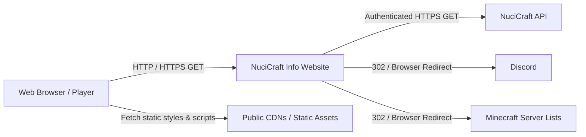
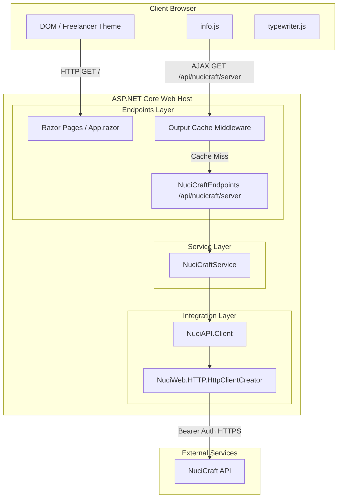
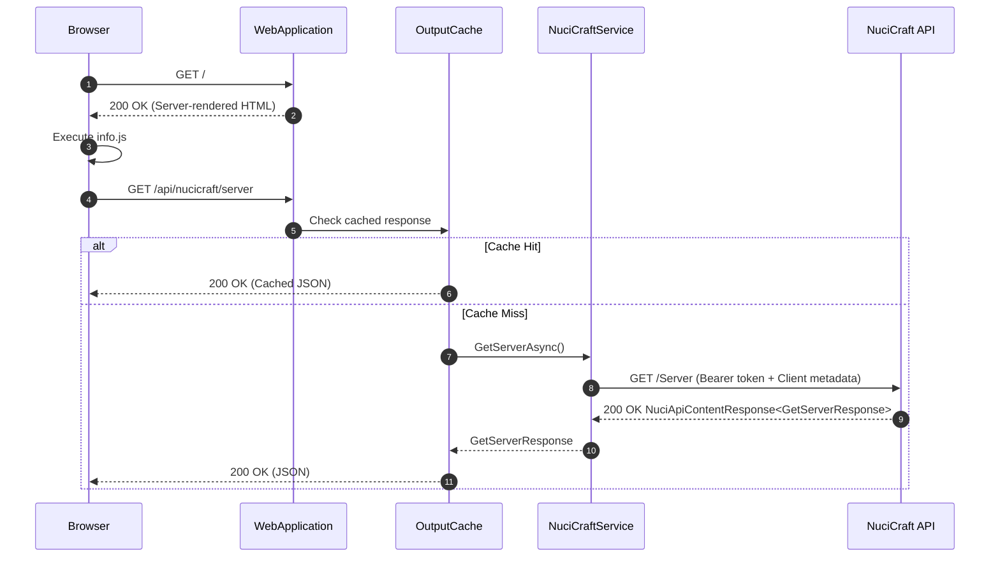
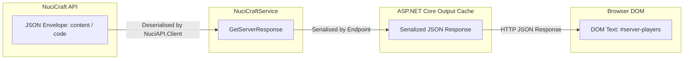
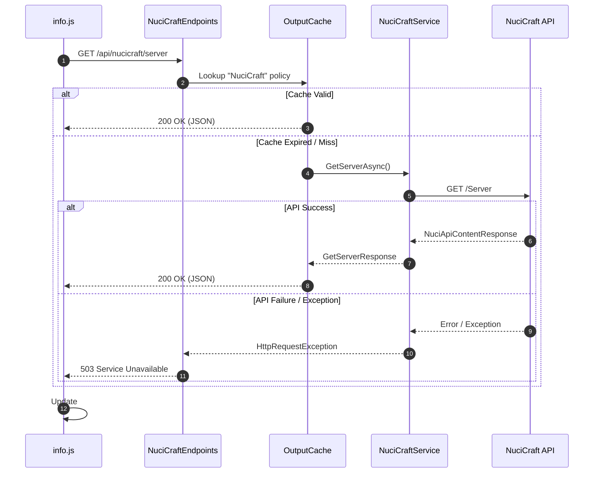
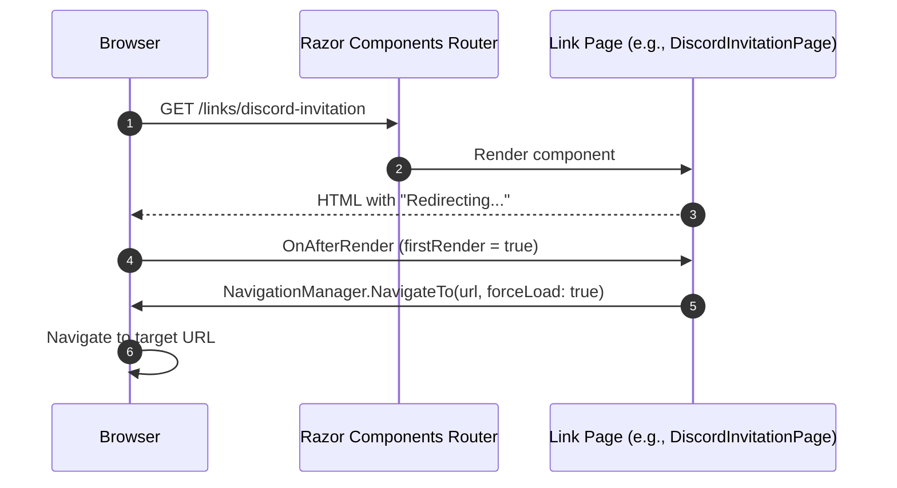
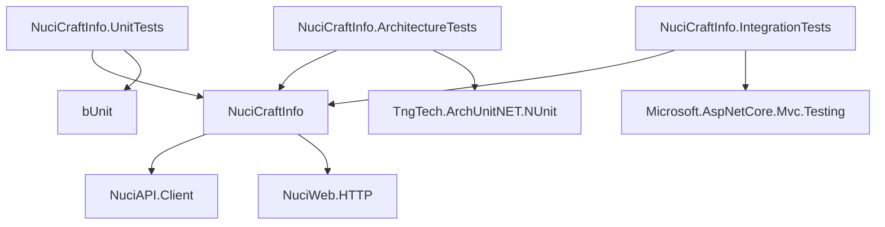

# NuciCraft Info Architecture

This document describes the current architecture of the NuciCraft Info website, covering the ASP.NET Core Blazor server host, the proxied server-information endpoint, the client-side presentation scripts, and the integration boundary with the NuciCraft API.

## 📑 Table of Contents

- [Purpose](#purpose)
- [System Context](#system-context)
- [Architectural Style](#architectural-style)
- [Runtime Process](#runtime-process)
- [Components](#components)
- [Architectural Areas](#architectural-areas)
  - [Web Presentation](#web-presentation)
  - [API Proxy and Endpoints](#api-proxy-and-endpoints)
  - [Application Service](#application-service)
  - [Static Client Assets](#static-client-assets)
- [Data Architecture](#data-architecture)
- [Interfaces and Integrations](#interfaces-and-integrations)
- [Key Processes](#key-processes)
  - [Live Player Count Retrieval](#live-player-count-retrieval)
  - [Legacy Short-Link Navigation](#legacy-short-link-navigation)
- [Cross-Cutting Concerns](#cross-cutting-concerns)
  - [Security and Privacy](#security-and-privacy)
  - [Error Handling](#error-handling)
  - [Observability](#observability)
  - [Configuration](#configuration)
  - [Concurrency and Resource Use](#concurrency-and-resource-use)
- [Dependency Direction and Rules](#dependency-direction-and-rules)
- [External Dependencies](#external-dependencies)
- [Deployment and Operations](#deployment-and-operations)
- [Compatibility Contracts](#compatibility-contracts)
- [Testing and Verification](#testing-and-verification)
- [Design Constraints](#design-constraints)
- [Extension Points](#extension-points)
  - [Additional Proxied NuciCraft Endpoints](#additional-proxied-nucicraft-endpoints)
  - [New Redirect Pages](#new-redirect-pages)
- [Source Map](#source-map)
- [Related Documentation](#related-documentation)

## 🎯 Purpose

NuciCraft Info provides public server connectivity guidance, community links, and live player count information for the NuciCraft Minecraft server. This document records the architectural boundaries of the ASP.NET Core Blazor application, the data flow from the external NuciCraft API through output caching to the browser, and the dependency rules governing contributors and future evolution.

## 🌐 System Context

NuciCraft Info acts as an edge web application and caching API proxy situated between web visitors and the upstream NuciCraft API.



The principal external boundaries are:
- **Web Browser / Player:** Inbound requests for the Blazor HTML pages, static web assets, and the `/api/nucicraft/server` JSON endpoint.
- **NuciCraft API:** Outbound HTTPS boundary providing Minecraft server metadata and online player counts over `NuciAPI.Client`.
- **Public CDNs:** Outbound browser-facing boundary delivering Bootstrap, Font Awesome, Google Fonts, and animation libraries.
- **Discord and Voting Portals:** Outbound browser navigation destinations for community engagement and server voting.

## 🏗️ Architectural Style

NuciCraft Info implements a modular monolith web application combining ASP.NET Core server-rendered Blazor components with an in-process caching minimal API proxy.



The principal architecture boundaries are:
- **Endpoints Layer:** Exposes server-side rendered Blazor components and the HTTP Minimal API endpoint with output caching.
- **Service Layer:** Encapsulates business logic, API request creation, and error classification via `INuciCraftService`.
- **Integration Layer:** Adapts the HTTP transport via `NuciAPI.Client` and `NuciWeb.HTTP`, managing protocol headers, serialisation, and upstream authentication.

## 🔄 Runtime Process



The principal runtime sequence is:
1. `Program.Main` initializes `WebApplicationBuilder`, validates configuration parameters (ensuring `CacheDurationInMinutes >= 30`), and registers services.
2. The HTTP middleware pipeline configures security headers (`HSTS`), HTTPS redirection, static file handling, antiforgery, and output caching.
3. Inbound page requests are mapped to `App.razor` via Blazor server-side rendering.
4. Client-side script `info.js` requests `/api/nucicraft/server`, which is fulfilled either from the output cache or via `NuciCraftService` delegating to the NuciCraft API.

## 🧩 Components

| Component | Responsibility | Principal Dependencies | Lifetime or Ownership |
|-----------|----------------|------------------------|-----------------------|
| `Program` | Application composition root, DI container setup, and middleware pipeline configuration. | `Microsoft.AspNetCore.Builder`, `Microsoft.Extensions.DependencyInjection` | Static process entry point |
| `App` | Root Razor component declaring document structure, HTML head, and script imports. | `Routes`, Blazor Web runtime | Per request |
| `Routes` | Client routing component resolving URL paths to Blazor page components. | `RouteView`, `MainLayout` | Per request |
| `Home` | Primary landing page presenting server details, modals, and player information. | `MainLayout`, static assets | Scoped to request |
| `NuciCraftEndpoints` | Minimal API endpoint mapping for `/api/nucicraft/server` with output cache integration. | `INuciCraftService`, `OutputCachePolicy` | Singleton registration |
| `NuciCraftService` | Domain service orchestrating server status requests, authentication metadata, and error translation. | `INuciApiClient`, `IConfiguration` | Singleton |
| `NuciApiClient` | External client library sending signed HTTP requests to the NuciCraft API. | `HttpClient`, `NuciWeb.HTTP` | Singleton |
| `HttpClient` | Network socket transport configured with timeout and IPv6/IPv4 socket defaults. | `HttpClientCreator` | Singleton |

## 🗂️ Architectural Areas

### Web Presentation

Paths:
- `NuciCraftInfo/Components/`
- `NuciCraftInfo/Components/Layout/`
- `NuciCraftInfo/Components/Pages/`
- `NuciCraftInfo/Components/Pages/Links/`

Responsibilities:
- Server-side rendering of HTML content.
- Route handling for root, error, not found, and link redirect pages.
- Inclusion of client-side scripts, styling, and metadata headers.

Boundary rules:
- Components depend on layout and navigation abstractions.
- Components must not directly instantiate HTTP clients or call external services.

### API Proxy and Endpoints

Paths:
- `NuciCraftInfo/Endpoints/`

Responsibilities:
- Exposing minimal API endpoints for client script consumption.
- Configuring and applying output cache policies.
- Translating transport and service exceptions into HTTP status codes (`503 Service Unavailable`).

Boundary rules:
- Endpoints depend only on `INuciCraftService` and ASP.NET Core routing abstractions.

### Application Service

Paths:
- `NuciCraftInfo/Service/`
- `NuciCraftInfo/Requests/`
- `NuciCraftInfo/Responses/`

Responsibilities:
- Encapsulating remote NuciCraft API operations.
- Constructing `NuciApiRequestAuthorisationInfo` with client identifiers and bearer tokens.
- Unwrapping `NuciApiContentResponse<T>` and converting API error codes into domain results.

Boundary rules:
- Services depend on `INuciApiClient` and `IConfiguration`.
- Services have no dependency on ASP.NET Core HTTP context or Razor components.

### Static Client Assets

Paths:
- `NuciCraftInfo/wwwroot/`
- `NuciCraftInfo/wwwroot/js/`
- `NuciCraftInfo/wwwroot/css/`

Responsibilities:
- Executing DOM animations and typewriter header effects.
- Fetching live player count via client-side AJAX.
- Serving robots exclusion rules.

Boundary rules:
- Scripts must degrade gracefully when DOM elements or endpoints are unreachable.

## 💾 Data Architecture

NuciCraft Info maintains no persistent database or on-disk state. Data architecture is restricted to in-memory caching and transient request DTOs.



| Data or Store | Owner | Representation and Storage | Lifecycle or Consistency |
|---------------|-------|----------------------------|--------------------------|
| `GetServerResponse` | `NuciCraftInfo.Responses` | C# record/class representing server name, host, ports, and online player count | Instantiated per API retrieval, garbage collected after response creation |
| Output Cache Store | ASP.NET Core Output Cache | In-memory HTTP response byte stream indexed by route policy `NuciCraft` | Cached for `NuciCraftApi:CacheDurationInMinutes` (minimum 30 minutes); discarded on restart |

## 🔌 Interfaces and Integrations

| Interface or Integration | Direction | Contract | Owner | Failure Semantics |
|--------------------------|-----------|----------|-------|-------------------|
| `/api/nucicraft/server` | Inbound | HTTP GET returning JSON `GetServerResponse` | `NuciCraftEndpoints` | Returns `503 Service Unavailable` on upstream failure or timeout |
| NuciCraft API `/Server` | Outbound | HTTPS GET with `Authorization: Bearer <key>`, returning `NuciApiContentResponse<GetServerResponse>` | `NuciCraftService` | Throws `HttpRequestException` on connection failure or non-success code; returns `null` on `NOT_FOUND` |
| `/links/*` Redirects | Inbound | HTTP GET returning 200 with immediate client-side `NavigationManager.NavigateTo(..., forceLoad: true)` | Link Razor pages | Direct browser navigation to external destination |

## 🔀 Key Processes

### Live Player Count Retrieval



The client script asynchronously invokes `/api/nucicraft/server`. If the output cache holds an unexpired entry, it returns immediately without upstream traffic. On miss, `NuciCraftService` constructs authorisation metadata, queries the NuciCraft API, validates the response, and populates the cache.

### Legacy Short-Link Navigation



When a user visits a legacy link route (such as `/links/discord-invitation.html` or `/links/discord-invitation`), the router renders the matching page. Upon first client render, `NavigationManager.NavigateTo` directs the browser to the target URL with `forceLoad: true`.

## 🧵 Cross-Cutting Concerns

### Security and Privacy

- **Transport Security:** Outside Development, `UseHsts` and `UseHttpsRedirection` enforce encrypted transport.
- **Secret Isolation:** The upstream API key (`NuciCraftApi:ApiKey`) is injected via configuration and never exposed in client bundles or public endpoints.
- **Privacy Assurance:** The application stores no cookies, runs no tracking scripts, and processes no personal visitor data. External assets are loaded directly by the browser from reputable CDNs.

### Error Handling

- **Endpoint Failures:** When `NuciCraftService` encounters an `HttpRequestException` (due to connectivity, invalid credentials, or upstream 5xx), `NuciCraftEndpoints` returns `503 Service Unavailable`.
- **Client Degradation:** `info.js` catches network and JSON parsing errors silently, leaving the default placeholder `—` visible.
- **Application Exceptions:** Unhandled exceptions in non-development environments are handled by `/Error`, suppressing stack traces and displaying diagnostic request IDs.

### Observability

- Emits structured application logs through ASP.NET Core `ILogger` providers.
- Captures activity tracing with `Activity.Current?.Id` and `TraceIdentifier` in error pages.
- Configured log levels suppress verbose ASP.NET Core framework logs below `Warning` in production.

### Configuration

| Configuration Area | Source | Responsibility | Supersede or Secret Policy |
|--------------------|--------|----------------|---------------------------|
| `NuciCraftApi:BaseUrl` | `appsettings.json`, Environment | Target URL for the upstream NuciCraft API | Command-line > Environment > `appsettings.json` |
| `NuciCraftApi:ApiKey` | Environment variable, CLI argument | Upstream bearer token | Secret value; must never be committed |
| `NuciCraftApi:CacheDurationInMinutes` | `appsettings.json`, Environment | Expiration lifetime for output caching | Minimum value 30 enforced at startup; requires restart to alter |
| `Logging:LogLevel` | `appsettings.json`, Environment | Minimum log severity thresholds | Standard ASP.NET Core hierarchy |

### Concurrency and Resource Use

- Single shared `HttpClient` created through `NuciWeb.HTTP.HttpClientCreator` with socket pooling and 30-second timeout.
- In-memory output cache prevents thundering herd issues on the external NuciCraft API.
- Fully asynchronous I/O across endpoints, services, and HTTP clients.

## 🧭 Dependency Direction and Rules



The principal dependency rules are:
- `NuciCraftInfo` depends on domain packages `NuciAPI.Client` and `NuciWeb.HTTP`.
- Presentation components and endpoints depend on service contracts (`INuciCraftService`).
- Test projects (`NuciCraftInfo.ArchitectureTests`, `NuciCraftInfo.UnitTests`, and `NuciCraftInfo.IntegrationTests`) reference `NuciCraftInfo`.
- Direct circular dependencies between architectural layers are prohibited.

## 📦 External Dependencies

| Dependency | Responsibility | Integration Boundary | Architectural Consequence |
|------------|----------------|----------------------|---------------------------|
| `NuciAPI.Client` | Client abstractions and serialization for the NuciCraft REST API | `NuciCraftService` | Binds request/response formats to NuciCraft API specifications |
| `NuciWeb.HTTP` | Standardised HTTP client factory and IPv6-capable socket creation | `Program.cs` composition root | Governs socket connection lifecycle and default HTTP timeouts |
| `Microsoft.AspNetCore.App` | Core web framework, Razor Components, and minimal APIs | Application-wide | Defines hosting and rendering lifecycle |

## 🚀 Deployment and Operations

The application compiles to a self-contained web service executable across Linux, macOS, and Windows.

| Concern | Current Design | Architectural Consequence |
|---------|----------------|---------------------------|
| Process Topology | Single self-contained process per instance | Stateless; can be deployed behind reverse proxies (Nginx, Caddy, Kestrel) |
| Scaling | Stateless horizontal scaling | Output cache is in-memory per node; multiple instances cache independently |
| Reverse Proxy | Enforces HTTPS redirection and HSTS headers | Upstream proxy must terminate TLS and forward headers appropriately |
| Secret Injection | Read from environment variables (`NuciCraftApi__ApiKey`) | Host environment must provide secrets prior to process startup |

## 🛡️ Compatibility Contracts

| Contract | Owner | Invariant | Verification | Change Policy |
|----------|-------|-----------|--------------|---------------|
| `/api/nucicraft/server` | `NuciCraftEndpoints` | Returns JSON representation of `GetServerResponse` | `NuciCraftInfo.IntegrationTests.Endpoints.ServerEndpointTests` | Additive properties allowed; field renames require updating `info.js` |
| `/links/*` URL Paths | Link Page Components | Both `.html` and extensionless paths redirect to external services | `NuciCraftInfo.UnitTests.Components.Pages.Links` | Paths must remain stable to preserve external bookmarks and voting sites |
| `CacheDurationInMinutes` | `Program.cs` | Minimum duration must be >= 30 | `StartupConfigurationTests` | Must remain >= 30 to satisfy upstream API rate protection |

## ✅ Testing and Verification

The test suite covers unit, integration, and architecture levels:
- **Architecture Tests (`NuciCraftInfo.ArchitectureTests`):** ArchUnit.NET rules evaluated against the compiled production assembly, together with Roslyn source rules over the embedded production and test sources, enforcing the namespace, layering, naming, member organisation, formatting, and test conventions.
- **Unit Tests (`NuciCraftInfo.UnitTests`):** bUnit tests executing Razor component rendering, DOM output, and navigation triggers in an isolated environment.
- **Integration Tests (`NuciCraftInfo.IntegrationTests`):** Full web application host tests leveraging `WebApplicationFactory<App>` and `StubHttpMessageHandler` to verify HTTP endpoints, authorization headers, and startup constraints without network dependencies.

Execute the principal automated verification with:

```bash
dotnet test
```

## ⚠️ Design Constraints

- **Upstream Cache Constraint:** `NuciCraftApi:CacheDurationInMinutes` cannot be set lower than 30 minutes to protect the upstream NuciCraft API from traffic spikes.
- **Server-Side Blazor Model:** Initial page loads are server-rendered; dynamic updates on the client rely on plain JavaScript (`info.js`) rather than Blazor WebAssembly or active WebSockets.
- **External CDN Dependency:** Stylistic themes and icons depend on third-party CDNs; offline execution degrades visually.

## 🔧 Extension Points

### Additional Proxied NuciCraft Endpoints

1. Define request and response contracts in `NuciCraftInfo/Requests/` and `NuciCraftInfo/Responses/`.
2. Add corresponding service methods to `INuciCraftService` and implement them in `NuciCraftService`.
3. Map the new route in `NuciCraftEndpoints.cs` and attach the output cache policy.

Extensions must preserve error handling semantics, returning `503 Service Unavailable` on upstream failure.

### New Redirect Pages

1. Add a new Razor component in `NuciCraftInfo/Components/Pages/Links/`.
2. Specify route templates for both extensionless and `.html` URLs.
3. Call `NavigationManager.NavigateTo(destination, forceLoad: true)` within `OnAfterRender(true)`.

## 🗺️ Source Map

| Area | Path |
|------|------|
| Web Host and Composition | `NuciCraftInfo/Program.cs` |
| Endpoints | `NuciCraftInfo/Endpoints/` |
| Service and Client Integration | `NuciCraftInfo/Service/` |
| Razor Components and Layout | `NuciCraftInfo/Components/` |
| Short-Link Pages | `NuciCraftInfo/Components/Pages/Links/` |
| Static Assets | `NuciCraftInfo/wwwroot/` |
| Unit Tests | `NuciCraftInfo.UnitTests/` |
| Architecture Tests | `NuciCraftInfo.ArchitectureTests/` |
| Integration Tests | `NuciCraftInfo.IntegrationTests/` |

## 📚 Related Documentation

- [README.md](./README.md): Project overview, configuration reference, build commands, and deployment guidance.
- [PRIVACY.md](./PRIVACY.md): Privacy policy and personal data processing statements.
- [LICENSE](./LICENSE): GNU General Public License v3 terms governing the repository.
